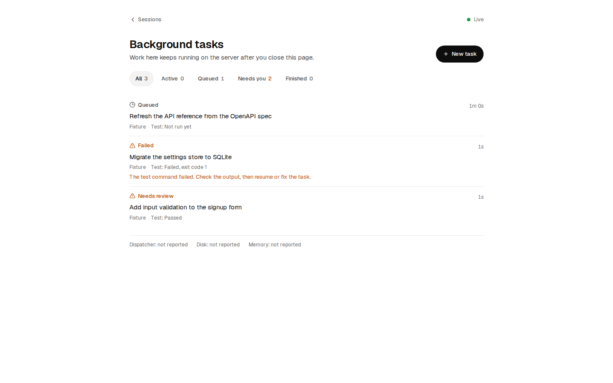

<div dir="rtl">

# مركز التحكم في تطوير البرمجيات بالذكاء الاصطناعي

**مساحة عمل ذاتية الاستضافة لـ Claude Code وOpenAI Codex، تدعم مهام تطوير مستمرة ومتعددة الوكلاء.**

[English](README.md) · [دليل الوثائق](docs/README.md) · [سياسة الأمان](SECURITY.md) · [ملاحظات الإصدار](docs/release-notes.md)

شغّل مهام التطوير على خادمك، وأغلق المتصفح أو اقفل الهاتف أو افصل الحاسوب عن الإنترنت. يمكنك العودة لاحقًا إلى لوحة التحكم لمراجعة المهام نفسها وسجلاتها وتغييراتها وحالة اعتمادها.

يجمع المشروع لوحة **agent-ui** مفتوحة المصدر مع طابور مهام دائم يعتمد على Python وSQLite، ومساحات Git Worktree منفصلة، وعمليات تنفيذ مستقلة تشرف عليها systemd. وهو مخصص لمطوّر موثوق أو لمشغّل مسؤول يدير حساباته الشخصية على خادم Ubuntu خاص. لا يُعدّ منصة آمنة لاستضافة مستخدمين غير موثوقين، ولا خدمة لمشاركة حسابات مزوّدي الذكاء الاصطناعي، ولا نظامًا للنشر الآلي في الإنتاج.

> **إصدار تجريبي:** النظام المستهدف هو Ubuntu 24.04 LTS بمعمارية x86_64. لم يُتحقق من دعم أنظمة أخرى، أو الاستكمال التلقائي لمهمة جارية بعد إعادة تشغيل الخادم بالكامل، أو اختبار تسجيل الخروج الفعلي من SSH. تعتمد قدرات الوكلاء على الحسابات وإصدارات الأدوات والصلاحيات. لا يتضمن المستودع أي بيانات دخول، ولا تستخدم اختبارات CI حسابات مدفوعة.

## المزايا الأساسية

- استمرار المهام: تشرف systemd على التنفيذ، ولا ترتبط حياة المهمة باتصال المتصفح.
- تعاون منظم: توزيع يدوي أو تخطيط عبر الوضع التلقائي، وفرع ومساحة عمل مستقلان لكل مهمة، مع حد أقصى لمهمتين ومهمة واحدة لكل مزوّد في الوقت نفسه.
- أدلة محفوظة: سجلات لكل محاولة، ونقاط استئناف، وأوامر، ونتائج اختبارات، وسجل للحالات والملكية.
- مراجعة صريحة: نجاح الاختبارات ينقل المهمة إلى المراجعة؛ لا يُعدّها مكتملة حتى يعتمدها مراجع محدد بعد إعادة الاختبار وفحص التعارضات.
- وصول محمي: ربط داخلي فقط، وتسجيل دخول للتطبيق، وخيار HTTPS موثوق مع طبقة مصادقة مستقلة.
- تشغيل محدود الموارد: مهلات زمنية، ومحاولات محدودة، وإيقاف عند مشكلات الحساب، وحدود للذاكرة والمعالج والعمليات.

## البنية العامة

المتصفح ← نفق SSH خاص أو HTTPS محمي ← وكيل داخلي ← لوحة التحكم والطرفية.

تُخزّن المهام في SQLite، ثم يوزّعها مشغّل systemd على وحدات مستقلة لـ Claude وCodex، لكل منها Git Worktree منفصل. تمر المخرجات بالاختبارات والمراجعة قبل إعلان اكتمال المهمة. راجع [مخطط البنية](README.md#architecture).

**استخدم صفحة Background tasks للعمل غير المراقب.** تختلف دورة حياة المحادثات التفاعلية؛ فقد تتوقف جولة Codex التفاعلية عند إعادة تشغيل خدمة اللوحة، بخلاف مهام الطابور المستقلة.

## التثبيت السريع

استخدم خادمًا جديدًا مدعومًا وحسابًا عاديًا يملك صلاحية sudo. يُنصح بـ 4–6 أنوية افتراضية، وذاكرة 8–12 GiB، ومساحة فارغة لا تقل عن 20 GiB. لا يغيّر المثبّت إعدادات SSH أو الجدار الناري.

نزّل الملفات الثلاثة من [الإصدار التجريبي](https://github.com/ENGHASKA/ai-development-control-center/releases/tag/v3.0.0-beta.1)، وافحص المثبّت وتحقق من البصمات قبل تشغيله:

</div>

```bash
version=3.0.0-beta.1
base="https://github.com/ENGHASKA/ai-development-control-center/releases/download/v$version"
mkdir adcc-install && cd adcc-install
curl -fLO "$base/install.sh"
curl -fLO "$base/ai-development-control-center-$version.tar.gz"
curl -fLO "$base/SHA256SUMS"
sha256sum --check SHA256SUMS
less install.sh
bash install.sh --install-system-deps
```

<div dir="rtl">

تتحقق البصمات من تطابق الملفات مع بيانات الإصدار المحمّلة، ولا تثبت هوية الناشر بصورة مستقلة. لا يُشغَّل نص محمّل مباشرة عبر curl. يستخدم خيار `--install-system-deps` صلاحية sudo لتثبيت حزم Ubuntu وتمكين استمرار مدير خدمات المستخدم، بينما يعمل التطبيق بحسابك العادي.

المسارات الافتراضية هي `~/.local/share/ai-development-control-center` للتطبيق، و`~/.local/state/ai-development-control-center` للمشاريع والحالة، و`~/.config/ai-development-control-center` للإعدادات الخاصة. يمكنك تغيير المسارات والمنفذ عبر `--prefix` و`--workspace` و`--port`.

ينشئ المثبّت بيانات دخول عشوائية خاصة بكل تثبيت، ويطبع أمرًا لعرض كلمة مرورك محليًا دون طباعتها في سجل التثبيت. يكتشف أدوات الوكلاء الموجودة أو يثبّت إصدارات محددة، ثم يبني اللوحة ويبدأ الخدمات ويفحص صحتها.

## الإعداد الأول وربط الحسابات

اتبع أمر نفق SSH الذي يطبعه المثبّت، ثم افتح `http://localhost:3310` عبر النفق المشفّر. للوصول العام دون نفق، استخدم اسم نطاق تتحكم فيه واتبع [دليل HTTPS](docs/public-https.md). **لا تكشف المنفذ 3310 مباشرة للإنترنت.**

اربط كل حساب بآلية تسجيل الدخول الرسمية الخاصة به:

</div>

```bash
claude auth login
claude auth status
codex login
codex login status
adcc doctor
```

<div dir="rtl">

قد توجد الأدوات التي ثبّتها المثبّت داخل `tools/node_modules/.bin` ضمن مسار التطبيق. يعرض `adcc config` مواقعها الفعلية. حسابات المزوّدين وفوترتهم مستقلة؛ الاشتراك لا يعني وصولًا غير محدود إلى API، ولا ينقل المشروع الرموز السرية بين الحسابات.

## إدارة المهام ومساحات Git

ضع مستودعًا موثوقًا داخل مجلد `projects/` في مساحة العمل، واضبط اسم مؤلف Git وبريده. أنشئ ملف JSON يحدد المستودع، ومالك المهمة، والوصف، وأمر اختبار حقيقي، والمهلة، وعدد المحاولات. راجع [المثال الإنجليزي](README.md#tasks-and-worktrees).

</div>

```bash
adcc task add ./task.json
adcc task list
adcc task show TASK_ID
adcc task logs TASK_ID
adcc task pause TASK_ID
adcc task resume TASK_ID
adcc task cancel TASK_ID
adcc task approve TASK_ID --reviewer YOUR_NAME
```

<div dir="rtl">

تحصل كل مهمة على فرع ومساحة عمل مستقلين. يمكن توزيع المهام يدويًا أو استخدام Auto Mode لتخطيط الخطوات وتوجيهها وتشغيل اختبارات معزولة ودمج المخرجات في فرع خطة منفصل. لا يتغير فرع المشروع إلا بعد إجراء دمج صريح من المشغّل. لا يدمج اكتمال المهمة أي فرع، ولا ينشر إلى الإنتاج. تنتظر المهام التابعة الاعتماد، لكنها لا تستورد تغييرات المهمة السابقة تلقائيًا؛ يجب مراجعة أساسها أولًا.

يقتصر Claude في مهام الخلفية افتراضيًا على أدوات الملفات، وتُنفّذ الاختبارات الموثوقة بصورة مستقلة. يحافظ Codex على عزل workspace-write ويرفض تصعيد الصلاحيات. يتطلب الحفظ الآلي في Git قائمة صريحة بالملفات المسموح بها ونجاح الاختبارات.

## الأمان والقيود

هذه أداة إدارية قادرة على تنفيذ تعليمات برمجية بصلاحيات المستخدم. ثق بالمشغّل والمستودعات والأوامر المحددة للاختبار. الطرفية ليست حاوية معزولة، وأقفال Git Worktree لا تمنع مستخدمًا موثوقًا من الوصول إلى ملفاته الأخرى.

تُحفظ الأسرار خارج Git بصلاحيات خاصة. تستخدم الجلسات ملفات ارتباط HttpOnly وSameSite=Strict، مع Secure عند HTTPS. توجد فحوص للمضيف ومصدر الطلب وتقييد لمحاولات تسجيل الدخول. يضيف النشر العام الاختياري TLS موثوقًا ومصادقة Basic مستقلة. لا يوجد تسجيل عام أو MFA مدمج، ولا إضافة لتحديد المعدل في Caddy القياسي. راجع [نموذج الأمان](docs/security.md).

قد يلزم تفعيل ملف Bubblewrap الرسمي ضمن AppArmor على Ubuntu. لا تعطّل AppArmor ولا تتجاوز العزل. توجد أيضًا مشكلة توافق قد تُعلّق TestClient متعدد الخيوط في Python داخل عزل Codex المقيد بالشبكة. استخدم اختبارات وحدات محدودة زمنيًا داخل الوكيل، واختبارات التكامل الموثوقة في المشغّل المستقل. التفاصيل في [استكشاف الأخطاء](docs/troubleshooting.md).

استعادة التنفيذ من نقطة محفوظة ليست استعادة لذاكرة العملية. الاستكمال بعد إعادة تشغيل الخادم بالكامل لم يُتحقق منه. اختبارات النشر الخاص أثبتت تشغيل الوكيلين واستمرار العمل بعد قطع المتصفح وإعادة تشغيل خدمات اللوحة والموزّع؛ ولا تعني ضمان نجاح كل إصدار أو مشروع.

## التحديث والنسخ الاحتياطي والإزالة

</div>

```bash
adcc backup /secure/location/adcc-backup.tar.gz
adcc restore /secure/location/adcc-backup.tar.gz --to /empty/staging/directory
adcc upgrade /path/to/reviewed/extracted/release
adcc uninstall
```

<div dir="rtl">

يرفض التحديث وجود مهام جارية، ويجهّز إصدارًا جديدًا مع استعادة الإعدادات والإصدار السابق عند الفشل. تُستعاد النسخة الاحتياطية إلى مجلد مرحلي فارغ؛ افحص المسارات المطلقة قبل تفعيلها. لا تُنسخ بيانات دخول المزوّدين أو اللوحة احتياطيًا. تحافظ الإزالة الآمنة على المشاريع والأسرار والإصدارات؛ تتطلب خدمة HTTPS ذات الصلاحيات الإدارية إزالة منفصلة بعد المراجعة.

## خارطة الطريق والمساهمة والدعم

تشمل الأولويات اختبارات إعادة تشغيل الخادم بموافقة المشغّل، وعزلًا أقوى على مستوى نظام التشغيل، وMFA، وتحسين تسليم المهام التابعة، وتوثيق منصات إضافية بعد اختبارها فعليًا. التخطيط التلقائي متاح الآن، أما النشر غير المراجع إلى الإنتاج فليس من الميزات الحالية.

راجع [دليل المساهمة](CONTRIBUTING.md) و[قواعد السلوك](CODE_OF_CONDUCT.md). استخدم [المشكلات](https://github.com/ENGHASKA/ai-development-control-center/issues) للأخطاء والاقتراحات، و[سياسة الأمان](SECURITY.md) للإبلاغ الخاص عن الثغرات. لا تنشر كلمات المرور أو السجلات الخاصة.

## الترخيص والشكر

كود المشروع مرخّص بموجب [MIT](LICENSE). تعتمد اللوحة على [agent-ui](https://github.com/pragnyanramtha/agent-ui)، مع مكونات Beautiful UI ورموز Nerd Font، وقد حُفظت إشعاراتها الأصلية. راجع [إشعارات الأطراف الثالثة](THIRD_PARTY_NOTICES.md). تخضع حزم المزوّدين المثبّتة بصورة منفصلة لشروطها الخاصة. المشروع غير تابع لـ Anthropic أو OpenAI ولا تدعمه أي منهما رسميًا.

</div>

<div dir="rtl">

## جلسات مستمرة وواجهة الإصدار الثاني

يمكن البحث عن محادثة Claude أو Codex محفوظة واستكمالها في طرفية مستمرة أو عبر جولات في الخلفية. يتحقق الخادم من الجلسة الأصلية والمجلد المعتمد والملكية الحصرية، ويرفض الاستكمال غير الصحيح بدل إنشاء محادثة بديلة. راجع [دليل استكمال الجلسات](docs/resuming-sessions.md) و[الوضع التلقائي](docs/auto-mode.md).

تعرض لقطات الشاشة واجهة التطبيق الفعلية على نسخة معزولة ببيانات اختبار توضيحية، وليست دليلًا على نشاط مدفوع للوكلاء.



</div>

<div dir="rtl">

## تحديث الإصدار الثالث

يضيف الإصدار الثالث استهدافًا موثوقًا للطرفيات، ومحادثات مستمرة لـ Claude وCodex، وتوجيهًا محسّنًا للوكلاء، ومراجعة مستقلة مع محاولات إصلاح محدودة. يمكن للمشرف إنشاء حسابات لأعضاء موثوقين وتحديد صلاحيات الجلسات وحمايتها برمز PIN قابل للإلغاء. هذا ليس عزلًا بين مستخدمي نظام التشغيل ولا مصادقة متعددة العوامل.

يبقى خيار Full Access معطلًا افتراضيًا، ولا يفعّله إلا مشرف بعد إقرار المخاطر؛ فهو يزيل عزل الوكيل ويتيح له صلاحيات حساب الخادم. لم تُفعّل هذه الصلاحية أثناء تجهيز الإصدار. تظل اختبارات فصل SSH وإعادة تشغيل الخادم والتحقق من الهواتف الفعلية غير مؤكدة.

</div>
