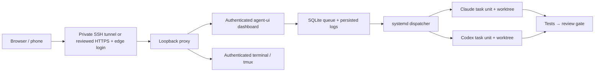
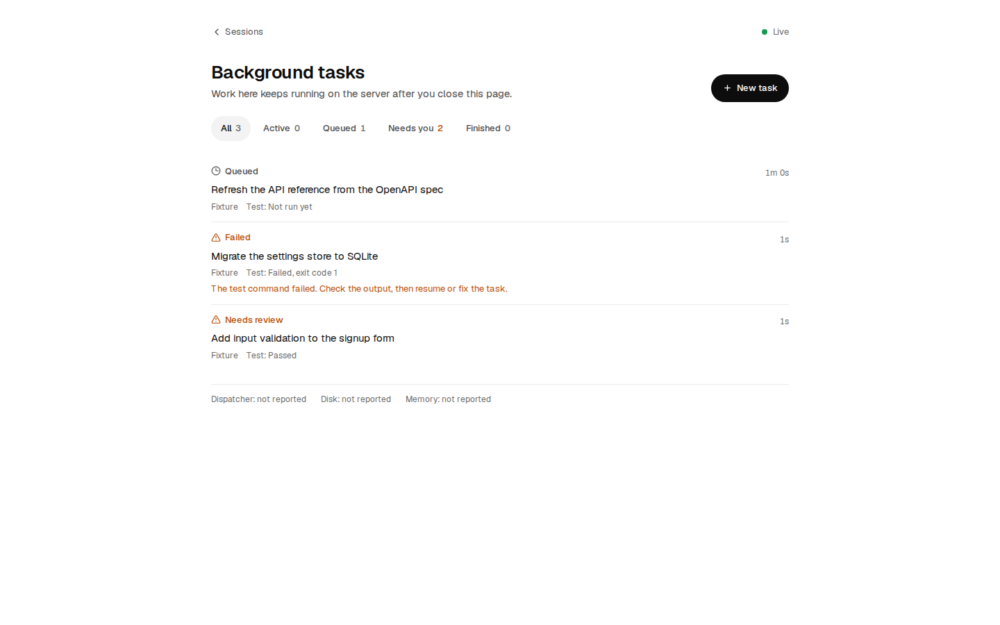
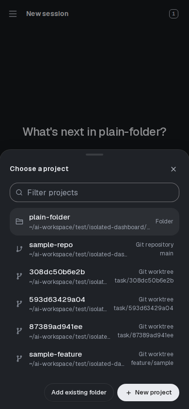

# AI Development Control Center

**A Self-Hosted Workspace for Claude Code, OpenAI Codex, and Persistent Multi-Agent Development.**

[العربية](README.ar.md) · [Documentation](docs/README.md) · [Security](SECURITY.md) · [Release notes](docs/release-notes.md)

Keep development work running on your server when you close the browser, lock your phone, or disconnect your laptop. Open the dashboard later to inspect the same tasks, logs, changes and review state.

AI Development Control Center combines the open-source **agent-ui** dashboard with a durable Python/SQLite queue, isolated Git worktrees and independent systemd executors. It is built for a trusted developer or small team's designated operator managing personal Claude Code and OpenAI Codex accounts on a private Ubuntu VPS. It is **not** a multi-tenant sandbox, a provider account-sharing service, or an autonomous production deployment system.

> **Beta:** Ubuntu 24.04 LTS on x86_64 is the supported installation target. Other operating systems, automatic mid-task continuation after a host reboot, and physical SSH logout acceptance are not verified. Agent features depend on your account, installed CLI and permissions. No provider credentials are included or required by CI.

## Why use it?

- **Work persists:** independent task units are owned by systemd, not a browser or WebSocket.
- **Agents can work together:** Auto Mode or manual task assignment, one branch/worktree per task, two slots and one running task per provider.
- **Evidence stays available:** attempt logs, checkpoints, commands, test results and owner/state history live on the server.
- **Review stays explicit:** passing tests moves a job to review. A named reviewer reruns tests and conflict checks before manual-task completion. Auto Mode integrates into a separate plan branch and requires an explicit operator merge; no automatic production deployment.
- **Access stays controlled:** loopback listeners, application login, private credentials, optional Caddy HTTPS plus independent Basic Authentication.
- **Operations stay bounded:** runtime/stall limits, capped retries, provider blocker circuits, memory/CPU/PID limits, health reports and safe lifecycle tools.

## Architecture



Interactive sessions now support finding and resuming the original Claude/Codex conversation in a kept terminal or as background turns. Resumption validates the saved session, approved folder and exclusive ownership; it refuses invalid resumes instead of silently starting over. Dashboard-native chat and kept terminal/background modes still have different restart behavior. Use a kept terminal or supervised background work for connection-independent sessions. Read [resuming sessions](docs/resuming-sessions.md).

## Auto Mode and the v3 interface

Select a trusted project, choose **Auto**, and describe the result. The server validates an agent-generated plan, routes up to eight steps, schedules dependencies in isolated worktrees, runs offline sandboxed tests, integrates passing changes into a separate `auto/` branch, and requests review. The project branch changes only when you explicitly choose **Merge into project**. Review findings start bounded repair rounds. When the budget is exhausted, the plan stops with findings for you to inspect. Provider usage and attempt limits still apply. [Auto Mode guide](docs/auto-mode.md).




These are real application screenshots from an isolated instance using labeled fixtures, not evidence of live provider work. [UI audit and screenshot provenance](docs/ui-audit.md).

## Quick installation

Use a fresh, supported VPS with a normal sudo-capable account. Recommended: 4–6 vCPU, 8–12 GiB RAM and at least 20 GiB free disk for two agents and builds. The installer refuses unsupported OS/architecture and does not change firewall or SSH settings.

Download all three files from [v3.0.0-beta.1](https://github.com/ENGHASKA/ai-development-control-center/releases/tag/v3.0.0-beta.1), inspect the installer, and verify checksums **before** running it:

```bash
version=3.0.0-beta.1
base="https://github.com/ENGHASKA/ai-development-control-center/releases/download/v$version"
mkdir adcc-install && cd adcc-install
curl -fLO "$base/install.sh"
curl -fLO "$base/ai-development-control-center-$version.tar.gz"
curl -fLO "$base/SHA256SUMS"
sha256sum --check SHA256SUMS
less install.sh
bash install.sh --install-system-deps
```

Checksums establish consistency with the downloaded release metadata, not independent author identity. This is deliberately not a curl-to-shell installer. Review the extracted Python installer as well if your policy requires reviewing all privileged dependency setup. `--install-system-deps` uses sudo only for Ubuntu packages and user lingering. The application itself runs as your normal account.

By default, installation uses `~/.local/share/ai-development-control-center`, state uses `~/.local/state/ai-development-control-center`, private configuration uses `~/.config/ai-development-control-center`, and the command is `~/.local/bin/adcc`. Override `--prefix`, `--workspace`, and `--port` as needed. No original server username or hostname is required.

The installer detects working CLIs or installs explicit versions locally, builds the dashboard from the lockfile, creates unique authentication material, starts private user services and checks health. It prints the local command for viewing **your** generated password, never the password itself. Add `~/.local/bin` to PATH if necessary.

## First run and accounts

For private access, follow the printed SSH forwarding command and open `http://localhost:3310` through the encrypted tunnel. For public access without a tunnel, configure a controlled DNS hostname and follow [trusted HTTPS setup](docs/public-https.md). **Do not publish port 3310 directly.**

Connect accounts separately using supported CLI flows:

```bash
claude auth login
claude auth status
codex login
codex login status
adcc doctor
```

Installer-local CLIs may live under the printed installation prefix's `tools/node_modules/.bin`; `adcc config` records their exact locations. Use those paths if they are not on your shell PATH. Subscriptions and API access/billing are separate. No token copying or undocumented subscription-to-API bridge is provided.

See [Claude integration](docs/claude-code.md), [Codex integration](docs/codex.md), and [authentication](docs/authentication.md).

## Tasks and worktrees

Create or clone a trusted Git repository inside your configured workspace's `projects/` directory. Set its Git author identity. Write a JSON task with a real acceptance test command:

```json
{
  "repo": "/absolute/path/to/workspace/projects/example",
  "owner": "codex",
  "prompt": "Implement the requested API. Preserve tests and report blockers.",
  "test": ["python3", "-m", "unittest", "discover", "-s", "tests"],
  "timeout": 3600,
  "stall_timeout": 900,
  "max_attempts": 2,
  "auto_resume": false
}
```

```bash
adcc task add ./task.json
adcc task list
adcc task show TASK_ID
adcc task logs TASK_ID
adcc task pause TASK_ID
adcc task resume TASK_ID
adcc task cancel TASK_ID
```

Each task gets a separate worktree and `task/TASK_ID` branch. Inspect and commit reviewed outputs, then use `adcc task approve TASK_ID --reviewer YOUR_NAME`. Passing a weak test command cannot prove correctness; choose acceptance tests carefully. Completion never merges a branch. Dependents wait for reviewed completion but do not incorporate predecessor code automatically.

Manual task assignment remains available alongside Auto Mode planning, deterministic routing and dependency integration. Claude's default background tools are restricted to file operations; trusted tests execute independently. Codex keeps workspace-write isolation and denies permission escalations in background mode. Optional auto-commits require an explicit allowed output list and passing tests. [Workflow guide](docs/multi-agent-workflows.md).

## Security and operational limits

This product can execute code as the installing user. Trust the operator, repositories, prompts and explicit test commands. A browser shell retains that user's permissions; worktree leases and file-browser checks do not create a container. Never expose it anonymously or invite untrusted users.

Credentials stay outside Git with private permissions. Cookies are HttpOnly and SameSite=Strict, and Secure under trusted HTTPS. Host/origin checks and application login throttling are enabled. Optional public Caddy ingress adds an independent high-entropy Basic Authentication password and trusted automatic TLS; no public registration exists. Caddy's stock build has no edge rate-limit plugin. Session PINs and trusted member accounts are supported; they are application access controls, not MFA or Unix-user isolation. See [security](docs/security.md).

Ubuntu's AppArmor restrictions can require the reviewed distro Bubblewrap profile before Codex commands work. Never disable AppArmor or bypass the sandbox. Restricted Codex commands can also hang threaded Python TestClient due to denied socket-pair wakeups. Use bounded direct unit tests inside the agent and explicit trusted integration tests in the worker; see [troubleshooting](docs/troubleshooting.md).

Default interruption handling blocks for inspection. Opted-in checkpoint/native-session continuation is bounded and is not restoration of process memory. Host reboot continuation remains unverified. Private deployment tests demonstrated actual concurrent CLI work, browser disconnect survival and dashboard/dispatcher restart survival; those results are not a guarantee that every installation or future CLI version works.

## Manage the installation

```bash
adcc doctor
adcc config
adcc backup /secure/location/adcc-backup.tar.gz
adcc restore /secure/location/adcc-backup.tar.gz --to /empty/staging/directory
adcc upgrade /path/to/reviewed/extracted/release
adcc uninstall
```

Upgrades refuse running tasks, stage a fresh version and restore the prior current/config on installation failure. Uninstall removes only managed user services and the command, retaining projects, credentials and release files. The optional privileged HTTPS service requires separate reviewed removal. Backups are private and include project/task state but exclude provider and dashboard credential stores; restoration is staged and requires inspecting absolute worktree paths before activation. [Updating](docs/updating.md) · [Backup and restore](docs/backup-restore.md).

## Roadmap and contributing

Planned: operator-assisted reboot acceptance, stronger per-project OS identity/container isolation, MFA integration, more installation targets after actual validation, and signed release provenance. Auto Mode planning and plan-branch integration are implemented. Public registration, unrestricted permission approvals and automatic production deployment are not features.

Contributions are welcome under [CONTRIBUTING.md](CONTRIBUTING.md) and the [code of conduct](CODE_OF_CONDUCT.md). Use [Issues](https://github.com/ENGHASKA/ai-development-control-center/issues) for reproducible bugs and suggestions. Report vulnerabilities privately as described in [SECURITY.md](SECURITY.md).

## License and acknowledgements

Our code is [MIT-licensed](LICENSE). The dashboard is derived from [pragnyanramtha/agent-ui](https://github.com/pragnyanramtha/agent-ui), including Beautiful UI adaptations and licensed Nerd Font symbols. Original notices are retained. See [third-party notices](THIRD_PARTY_NOTICES.md). Provider packages are installed separately under their own terms; this project is not affiliated with or endorsed by Anthropic or OpenAI.

## Access controls and persistent conversations

Claude and Codex run as kept terminal conversations by default, with verified socket/pane targets for input and delivery-safe queued messages. Resume continues a saved conversation instead of silently replacing it. A provider can still stall on a model request; persistence is not a guarantee of a reply.

Administrators can create trusted member accounts, grant per-session View/Interact/Manage access, and add revocable PIN protection. Member access is denied by default outside authorized sessions. These controls do not separate Unix users: trust members as you would trust people using this server account. [Access and team guide](docs/access-and-team.md).

Read only, Ask before acting and Accept edits have explicit provider flags. Full Access is disabled by default and requires an administrator's deliberate opt-in and confirmation; it removes the agent sandbox and can reach anything that Unix account can. This release process does not enable it or run live providers. Never use it to get around a failed test or sandbox gate.
